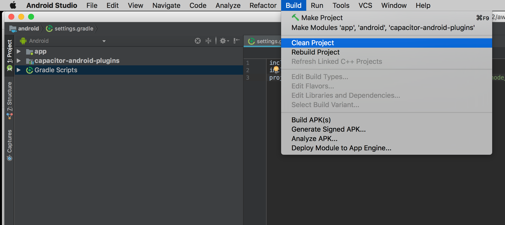
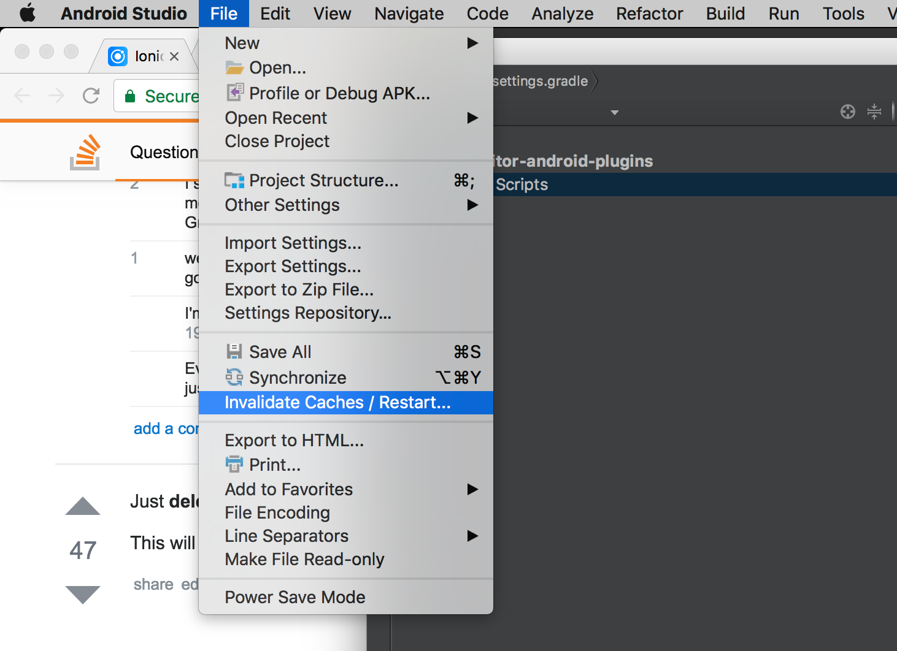
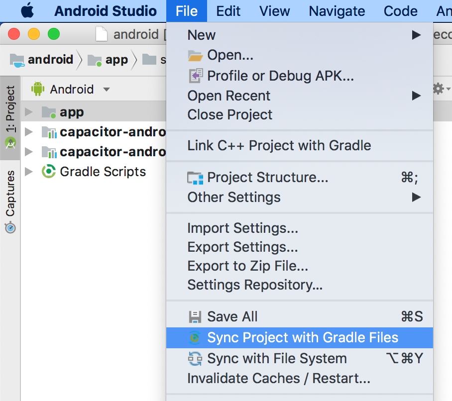
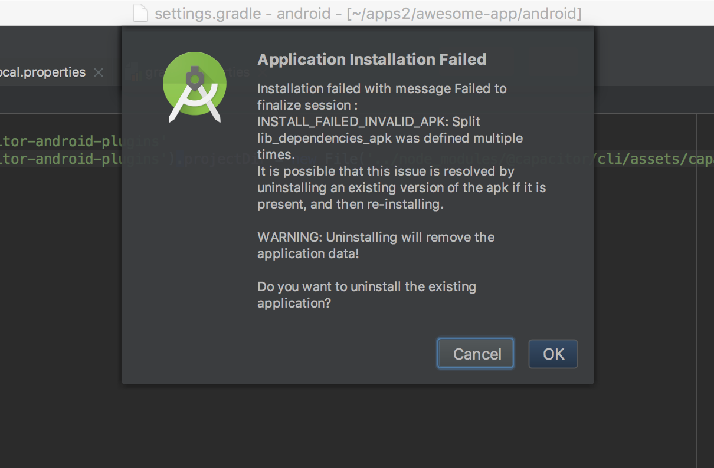
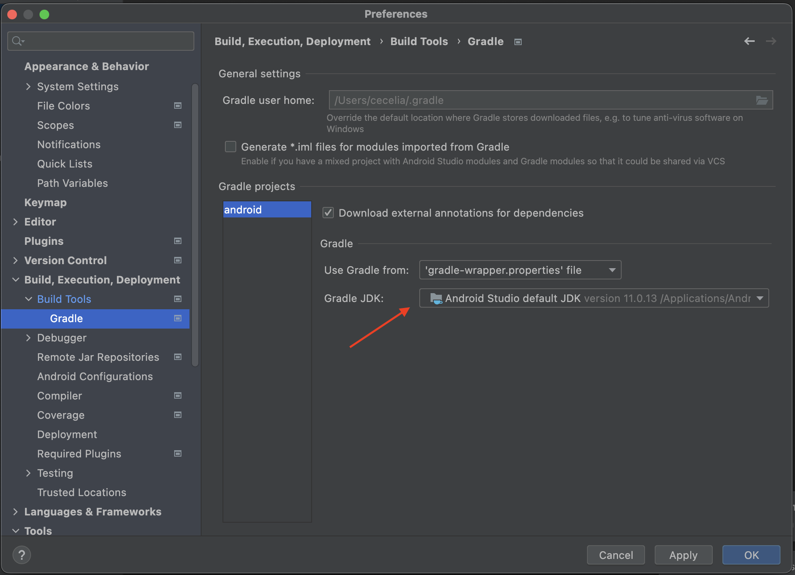

# Troubleshooting Android Issues

Creating a 100% perfect native management tool is nearly impossible, and sooner or later you'll run into various issues with some part of the Android workflow.

This guide attempts to document common Android issues with possible solutions.

## Android Toolbox

Every Android developer learns a few common techniques for debugging Android issues, and you should incorporate these into your workflow:

### Google, Google, Google

Any time you encounter an issue with Android, or Gradle, or Emulators, your first step should be to copy and paste the error into a Google search.

Capacitor uses the standard Android toolkit, so chances are if you run into something, many Android developers have as well, and there's a solution out there.

It could be as simple as updating a dependency, running Gradle sync, or invalidating caches.

### Gradle Sync

If you have installed a new Plugin from npm and are unable to use or see the plugins in your Android build, try using the "Sync Project with Gradle Files" button in the top right of Android Studio (the icon looks like an elephant). This will re-sync your native Android code to include the new plugin code and should allow use of your new plugin. For more info, see [this issue on Github](https://github.com/ionic-team/capacitor/issues/4012).

It can also help with many other seemingly random issues, so running "Sync Project with Gradle Files" is always a good first step when running into most Android build issues.

### Clean/Rebuild

Cleaning and rebuilding can fix a number of build issues:



### Invalidate Caches/Restart

If you're confident you fixed an issue, but Android Studio or Gradle doesn't agree, often the solution is to have Android Studio invalidate its caches and restart the program.

That can be done easily from the File menu:



## Error: "package android.support.\* does not exist"

This error occurs when some Cordova or Capacitor plugin has old android support dependencies instead of using the new AndroidX equivalent.
You should report the issue in the plugin repository so the maintainers can update the plugin to use AndroidX dependencies.

As a workaround, you can also patch the plugin using jetifier:

```bash
npm install jetifier
npx jetify
npx cap sync android
```

## Error: "Please select Android SDK"

This error is often due to Gradle needing to be synced, something you'll need to do
periodically after updating dependencies and changing project settings.

To manually sync Gradle, open File -> Sync Project with Gradle Files from the main menu bar:



## Error: "APK Can't be installed"

An APK not installing to an Emulator or Device is often due to having an existing app with the same package name. You may see an error like this when trying to run your app:



The solution is to remove any old apps and make sure your package name is up to date in `AndroidManifest.xml` and not conflicting with other apps you are developing.

Finally, do a clean and rebuild just in case.

## Error: "Unable to locate a Java Runtime"

This error may occur when using the `run` command if the `JAVA_HOME` environment variable is not set. 

To resolve, set `JAVA_HOME` as an environment or system variable using the path found in Android Studio under Preferences > Build, Execution, Deployment, Build Tools > Gradle > Gradle JDK.



On Mac, this can be updated in your `.zshrc` or `.bashrc` file or exported in your environment.

```bash
export JAVA_HOME="/Applications/Android Studio.app/Contents/jbr/Contents/Home"
```

On Windows, you can set `JAVA_HOME` as a System Variable under your Environment Variables settings.

## Recreating your project

Capacitor lets you manage your own Android project. Like any IDE-backed project, sometimes things get so out of sync that the only solution is to rebuild the project.

To do this, follow these steps:

1. Copy any source code you created (such as Java files in `app/android/src`, manifest files, or resource files) into a safe location outside of `app/android`.
2. Next, make sure you are running an updated version of the Capacitor CLI: `npm install @capacitor/cli@latest`
3. Remove the android directory: `rm -rf android/`
4. Re-create the Android app from Capacitor: `npx cap add android`
5. Copy your saved source files back into the project

## Plugin Not Implemented

On Android, this can happen if Capacitor doesn't find the plugins or can't inject its code into the WebView.

First of all, make sure the plugin is installed and appears in the `package.json`.

Then, run `npx cap sync android`.

Finally, use the "Sync Project with Gradle Files" button in the top right of Android Studio (the icon looks like an elephant). This will re-sync your native Android code to include the new plugin code and should allow use of your new plugin.

Also, if you are migrating from Capacitor 1 or 2, make sure you enabled the [automatic plugin loading](https://capacitorjs.com/docs/updating/3-0#switch-to-automatic-android-plugin-loading).

If still getting the "Plugin not implemented" error, make sure you are not using service workers, that prevents Capacitor's and Plugins code from injecting. Or if you want to use them, you can use [this workaround](https://github.com/ionic-team/capacitor/issues/1655#issuecomment-579229390) for making the injection work.

## Using R8

R8 shrinks, optimizes and obfuscates your app's code when `minifyEnabled` is `true` in the release block of `app/build.gradle`. It's on by default in Capacitor 9 apps. To turn it off, set `minifyEnabled false`.

Capacitor and the official plugins ship the rules they need, so most apps don't need rules of their own. R8 only runs in release builds, so test a release build before publishing.

### When something fails only in release

R8 removes or renames code it can't see being used, such as classes looked up by name, code called from native code, and Gson models without `@SerializedName`. Find the class in the error and add a keep rule for it to `app/proguard-rules.pro`:

```
-keep class com.example.MyModel { <fields>; }
```

Keep the rule as narrow as you can, since keeping a whole package stops R8 from optimizing all of it. If the class comes from a plugin, report it to the plugin's author so the plugin can ship the rule.

If the release build fails with "Missing classes", add the rules R8 lists in `app/build/outputs/mapping/release/missing_rules.txt`.

### Libraries with old keep rules

AGP 9 no longer keeps a constructor just because its class is kept. Older versions of these libraries relied on that, so they fail at runtime under R8. If your app's own dependencies bring one of them, upgrade it or add its rule to `app/proguard-rules.pro`:

| Library | Fixed in | Rule |
| :------ | :------- | :--- |
| Room | 2.7 | `-keep class * extends androidx.room.RoomDatabase { <init>(); }` |
| WorkManager | 2.10 | `-keepclassmembers class * extends androidx.work.InputMerger { <init>(); }` |
| firebase-components, used by Firebase and ML Kit | 18.0.1 | `-keep class * implements com.google.firebase.components.ComponentRegistrar { <init>(); }` |

If another library fails the same way, copy its class-only keep rule into `app/proguard-rules.pro` and add `{ <init>(); }` to it.

### Stack traces

R8 writes the map of renamed classes and methods to `app/build/outputs/mapping/release/mapping.txt` and adds it to your AAB, where Google Play reads it. The Crashlytics Gradle plugin uploads it too. To decode a stack trace yourself, use [retrace](https://developer.android.com/tools/retrace).

### Resource shrinking

`shrinkResources` stays off by default. Google Play's code optimization scores only measure your app's code, so resource shrinking barely changes them, though Play Console lists it as off. If you turn it on, keep the resources your app only reads by name, such as notification icons and sounds named in `capacitor.config.json`, with a file like `app/src/main/res/raw/keep.xml`:

```xml
<resources xmlns:tools="http://schemas.android.com/tools" tools:keep="@drawable/ic_stat_notify" />
```

### Capacitor 8

Capacitor 8 apps have R8 off by default. To turn it on, use Capacitor 8.5.4 or later and also switch to `proguard-android-optimize.txt`, since `proguard-android.txt` turns off R8's optimizations:

```diff
buildTypes {
    release {
-       minifyEnabled false
-       proguardFiles getDefaultProguardFile('proguard-android.txt'), 'proguard-rules.pro'
+       minifyEnabled true
+       proguardFiles getDefaultProguardFile('proguard-android-optimize.txt'), 'proguard-rules.pro'
    }
}
```
