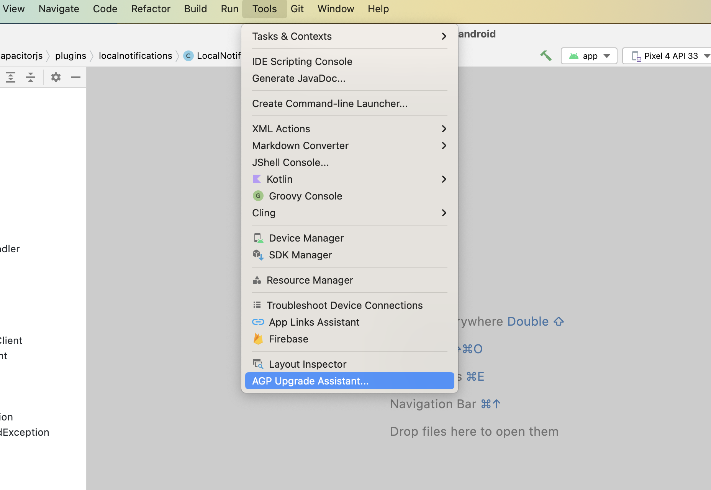

# Updating from Capacitor 8 to Capacitor 9

In this guide, you'll find steps to update your project to the current Capacitor 9 version as well as a list of breaking changes for our official plugins.

:::note
This guide covers app-level changes. If you maintain a Capacitor plugin, see [Updating plugins to 9.0](/main/updating/plugins/9-0.md) instead.
:::

## Cordova support is now optional

Capacitor's Cordova compatibility layer is now only included in your app when your project actually has a Cordova plugin installed. Previously, the native Cordova runtime (the Cordova framework and the Cordova plugins module on Android, and the `CapacitorCordova` CocoaPods pod / `Cordova` SPM product on iOS) was always bundled into every app, whether or not it used any Cordova plugins.

Running `npx cap sync` (or `update`) now detects whether any installed plugin is a Cordova plugin and only wires in the Cordova runtime when one is found. If your project has no Cordova plugins, you'll notice:

- On Android, the Cordova runtime moved out of `capacitor-android` into a separate `capacitor-cordova-android` module. The generated `capacitor.settings.gradle` and `app/capacitor.build.gradle` include it, and the `capacitor-cordova-android-plugins` module, only when the Cordova runtime is needed.
- On iOS, `CapacitorCordova` is no longer added to your `Podfile` or `Package.swift`.

If your app's native code (or a plugin you maintain) directly references symbols from Capacitor's Cordova compatibility layer — for example `com.getcapacitor.cordova.CordovaPlugin` on Android, or anything from the `CapacitorCordova` pod/product on iOS — without having an actual Cordova plugin installed, those references will fail to resolve after upgrading. To keep the layer, set [`forceCordovaInclusion`](/main/reference/config.md) to `true` in your Capacitor config, which wires in the Cordova runtime on both platforms even with no Cordova plugin installed. Otherwise, remove the direct reference.

Android projects created before Capacitor 9 also reference the Cordova plugins module from files the CLI doesn't regenerate. `npx cap migrate` removes those references. To remove them by hand, delete these lines, which the generated files now add back only when the Cordova runtime is needed:

```diff
# android/settings.gradle

 include ':app'
-include ':capacitor-cordova-android-plugins'
-project(':capacitor-cordova-android-plugins').projectDir = new File('./capacitor-cordova-android-plugins/')

 apply from: 'capacitor.settings.gradle'
```

```diff
# android/app/build.gradle

-repositories {
-    flatDir{
-        dirs '../capacitor-cordova-android-plugins/src/main/libs', 'libs'
-    }
-}
-
 dependencies {
     ...
-    implementation project(':capacitor-cordova-android-plugins')
 }
```

If no Cordova plugin is installed and `forceCordovaInclusion` isn't set, leaving these lines in place breaks the Gradle build with `Could not get unknown property 'cdvPluginPostBuildExtras' for project ':capacitor-cordova-android-plugins'`. `npx cap migrate` only removes lines that match the Capacitor 8 template exactly, and doesn't warn when they don't (for example, with Windows line endings), so check both files after migrating. It also removes the whole `repositories` block, `libs` included: if your app references `.aar` files in `app/libs` by name, add back `repositories { flatDir { dirs 'libs' } }`.

On iOS, `npx cap sync` regenerates the `Podfile` and `Package.swift` entries, so there's nothing to change by hand.

## Breaking changes in @capacitor/cli

`cap run`'s separate live-reload flags (`--live-reload`/`-l`, `--host`, `--port`, `--https`) have been merged into a single `--url` flag. Instead of:

```sh
npx cap run android -l --host 192.168.1.181 --port 5173
```

pass the full URL your dev server printed (Vite, webpack, etc.) directly:

```sh
npx cap run android --url http://192.168.1.181:5173
```

## NodeJS 24+

Capacitor 9 requires NodeJS 24 or greater. (Latest LTS version is recommended.) Node 24 also comes with npm 11 by default, as opposed to npm 10 with Node 22.

## Using the CLI to Migrate

Install the CLI:

```sh
npm i -D @capacitor/cli@latest
```

Once installed, simply run the following to have the CLI handle the migration for you.

```sh
npx cap migrate
```

If any of the steps for the migration are not able to be completed, additional information will be made available in the output in the terminal. The steps for doing the migration manually are listed out below.

If you use npm 12 and `npx cap migrate` reports blocked install scripts, approve them as described in [npm 12](/main/getting-started/environment-setup.md#npm-12), then run `npx cap sync`.

If you migrate by hand, first update the rest of the Capacitor packages and each Capacitor plugin you use to the same version as the CLI, for example:

```sh
npm i @capacitor/core@latest @capacitor/ios@latest @capacitor/android@latest @capacitor/app@latest
```

Then apply the steps below and finish with `npx cap sync`, which regenerates the native files that depend on your installed plugins.

Whichever path you take, finish with the [iOS verification checklist](#verify-the-ios-migration). `npx cap migrate` rewrites the same entry point files the manual steps do, so a migrated project needs the same checks as a hand-edited one.

## Breaking changes in @capacitor/android

`androidx.core:core` 1.19.0 folds `core-ktx` into itself, and AGP 9 bundles the Kotlin Gradle Plugin natively while Gradle 9 fully removes `jcenter()`. These rarely affect an app directly, unless you (or an old/community plugin) still pin an old `core-ktx` version, apply Kotlin standalone, or reference `jcenter()` — see [Migrate core-ktx to core](#migrate-core-ktx-to-core) and [Update Kotlin and remove jcenter()](#update-kotlin-and-remove-jcenter) below.

Capacitor 9 also removes the Java APIs that were deprecated in previous major versions, most of them used by plugin authors — see [Breaking changes in code](/main/updating/plugins/9-0.md#android). If your app has custom native code, check that list too.

Release builds now run R8 by default, which can break code that R8 can't see being used. See [Turn on R8 in release builds](#turn-on-r8-in-release-builds) below.

The System Bars plugin now defaults `insetsHandling` to `'native'`, which no longer injects the `--safe-area-inset-*` CSS variables, and `MainActivity` enables edge-to-edge. See [Enable edge-to-edge](#enable-edge-to-edge) and [System Bars](#system-bars) below.

## Breaking changes in @capacitor/ios

Capacitor 9 boots iOS apps from a SwiftUI `App` struct instead of a UIKit `AppDelegate`. Your app project gains `App.swift` and `CapacitorView.swift`, the `AppDelegate` is demoted to a `@UIApplicationDelegateAdaptor`, your `SceneDelegate` is emptied out, and `Main.storyboard` is deleted. Every app needs this change, including apps already on 8.5 — see [Adopt the SwiftUI entry point](#adopt-the-swiftui-entry-point) below.

If you're updating from Capacitor 8.4 or earlier, read [Updating to 8.5](/main/updating/8-5.md) as well. It covers the iOS UIScene lifecycle that the SwiftUI entry point builds on, and its audit section lists the custom native code patterns that both changes affect.

Capacitor 9 also removes the Swift and Objective-C APIs that were deprecated in previous major versions, most of them used by plugin authors — see [Breaking changes in code](/main/updating/plugins/9-0.md#ios). If your app has custom native code (for example `CAPBridge.handleOpenUrl` in your AppDelegate), check that list too.

Swift Package Manager projects now build Capacitor from source in `node_modules/@capacitor/ios` instead of downloading the prebuilt `capacitor-swift-pm` package, and no longer use `debug.xcconfig`. See [Swift Package Manager projects](#swift-package-manager-projects) below.

## iOS

The following guide describes how to upgrade your Capacitor 8 iOS project to Capacitor 9.

### Upgrade Xcode

Capacitor 9 requires Xcode 27 or newer.

### Raise iOS Deployment Target

Capacitor 9 requires iOS 16.0 or greater.

Do the following for your Xcode project: select the **Project** within the project editor and open the **Build Settings** tab. Under the **Deployment** section, change **iOS Deployment Target** to **iOS 16.0**. Repeat the same steps for any app **Targets**.

Then, if the project is using CocoaPods, open `ios/App/Podfile` and update the iOS version to 16.0:

```ruby
platform :ios, '16.0'
```

### Apply the recommended project settings

`npx cap migrate` turns on the build settings Apple recommends for current Xcode projects. It writes them into every build configuration of the project and of each target, and writes them again each time it runs, replacing values you changed:

| Build setting                                   | Value | Effect                                                                               |
| ----------------------------------------------- | ----- | ------------------------------------------------------------------------------------ |
| `CLANG_WARN_DEPRECATED_OBJC_IMPLEMENTATIONS`    | `YES` | Warns when Objective-C code implements a deprecated method.                          |
| `CLANG_WARN_OBJC_IMPLICIT_RETAIN_SELF`          | `YES` | Warns when an Objective-C block retains `self` implicitly.                           |
| `CLANG_WARN_QUOTED_INCLUDE_IN_FRAMEWORK_HEADER` | `YES` | Warns about quoted includes in framework headers.                                    |
| `STRING_CATALOG_GENERATE_SYMBOLS`               | `YES` | Generates Swift symbols for String Catalog keys.                                     |
| `ENABLE_USER_SCRIPT_SANDBOXING`                 | `YES` | SPM projects only. Run Script phases can only read and write the files they declare. |

The settings are optional: new Capacitor 9 projects don't set them, and an app builds without them. The first four only add compiler warnings or generated symbols. User script sandboxing is the one that can break a build, which is why the migrator leaves it off for CocoaPods projects: the script phases CocoaPods adds fail under it. If your App target has Run Script phases of your own (for example, to upload crash symbols), list the files each script reads in **Input Files** and the files it writes in **Output Files**, or set `ENABLE_USER_SCRIPT_SANDBOXING` back to `NO` on the App target and on any other target with Run Script phases. A `NO` at project level has no effect, because the migrator sets the value on each target, and running `npx cap migrate` again turns it back on.

To apply the settings by hand, select the **Project** in the project editor, open the **Build Settings** tab with **All** selected, search for each setting by name, and set it to **Yes**. In a CocoaPods project, skip `ENABLE_USER_SCRIPT_SANDBOXING`.

### Swift Package Manager projects

These changes only apply if your iOS project uses Swift Package Manager. CocoaPods projects can skip to [Adopt the SwiftUI entry point](#adopt-the-swiftui-entry-point).

#### Capacitor builds from node_modules

In Capacitor 8, `ios/App/CapApp-SPM/Package.swift` downloaded Capacitor as prebuilt binaries from the `capacitor-swift-pm` repository. In Capacitor 9 it points at the `@capacitor/ios` npm package you already have installed, and Xcode compiles Capacitor from source along with your app:

```diff
     dependencies: [
-        .package(url: "https://github.com/ionic-team/capacitor-swift-pm.git", exact: "8.6.2")
+        .package(name: "capacitor", path: "../../../node_modules/@capacitor/ios")
     ],
```

You don't edit this file by hand: `npx cap sync ios` regenerates it. Sync also repoints the `Package.swift` of each SPM plugin from `capacitor-swift-pm` to the same package, so your app and its plugins share one copy of Capacitor, and it warns about plugins built for another major version of Capacitor.

A few things follow from this:

- Run `npm install` and then `npx cap sync ios` before Xcode resolves packages. A CI pipeline that builds the iOS app needs the same steps before `xcodebuild`.
- The first build after updating takes longer, because Xcode compiles Capacitor itself.
- If Xcode fails to resolve packages after the update, [reset the package caches](/main/ios/spm.md#troubleshooting).

#### Ignore Package.resolved

Tools that resolve the `CapApp-SPM` package on their own, such as the Swift extension for VS Code, write a `Package.resolved` lock file next to its `Package.swift`. It's a local build artifact, so Capacitor 9 projects ignore it in `ios/App/CapApp-SPM/.gitignore`, and `npx cap migrate` adds the entry to existing projects:

```diff
+/Package.resolved
```

If you already committed the file, stop tracking it with `git rm --cached ios/App/CapApp-SPM/Package.resolved`. Xcode's own lock file, in `App.xcodeproj/project.xcworkspace/xcshareddata/swiftpm/`, is a different file and isn't affected.

#### Remove debug.xcconfig

SPM projects created before Capacitor 9 have an `ios/debug.xcconfig` that sets `CAPACITOR_DEBUG = true` for Debug builds, and a `CAPACITOR_DEBUG` key in `Info.plist` that passes the value on. The prebuilt Capacitor binary read that key to make the web view inspectable in debug builds, because it couldn't see your app's `DEBUG` flag. Capacitor 9 compiles from source and checks `DEBUG` directly, so the file and the key are unused.

`npx cap migrate` removes them:

- If `debug.xcconfig` only sets `CAPACITOR_DEBUG = true`, it unsets it as the Debug configuration file of the project and the App target, then deletes it.
- If the file sets anything else, it keeps the file and warns you to delete the `CAPACITOR_DEBUG` line yourself.
- In both cases, it removes the `CAPACITOR_DEBUG` key from `Info.plist`.

To remove them by hand:

1. Remove the key from `ios/App/App/Info.plist`:

   ```diff
   -    <key>CAPACITOR_DEBUG</key>
   -    <string>$(CAPACITOR_DEBUG)</string>
   ```

2. If `ios/debug.xcconfig` only sets `CAPACITOR_DEBUG = true`, select the **Project** in the project editor and open the **Info** tab. Under **Configurations**, expand **Debug** and set the configuration file of both the project and the App target to **None**. Then delete `debug.xcconfig` from the project navigator, choosing **Move to Trash**. If you edit `project.pbxproj` by hand instead, remove the two `baseConfigurationReference` lines that point at the file, its `PBXFileReference`, and its entry in the main group. If the file holds build settings of your own, keep it and delete only the `CAPACITOR_DEBUG = true` line.

Web inspection stays on in debug builds, and `ios.webContentsDebuggingEnabled` in your Capacitor config still overrides it. If code or build settings of your own read `CAPACITOR_DEBUG`, from `Info.plist` or as `$(CAPACITOR_DEBUG)`, they get no value after the migration. Check the `DEBUG` compilation condition instead.

### Adopt the SwiftUI entry point

`@main` moves out of `AppDelegate.swift` into a new `App.swift`, SwiftUI declares the app's scene, and `CAPBridgeViewController` is hosted inside that scene through a `UIViewControllerRepresentable`. The UIKit entry point it replaces — `Main.storyboard`, the `UIWindow` the AppDelegate owned, and the window setup in your `SceneDelegate` — is removed.

:::warning
Swift 6 (bundled with Xcode 27) rejects the deprecated `@UIApplicationMain` attribute, but don't replace it with `@main`. In Capacitor 9 `@main` belongs on the `App` struct in `App.swift`. Delete the attribute from `AppDelegate` instead — an app that declares two entry points doesn't compile.
:::

These are the files that change:

- `App.swift` — new. An `@main` struct conforming to `App`. It adopts the `AppDelegate` through `@UIApplicationDelegateAdaptor` and declares a `WindowGroup` scene containing `CapacitorView()`.
- `CapacitorView.swift` — new. A `UIViewControllerRepresentable` that makes `CAPBridgeViewController` available to SwiftUI.
- `SceneDelegate.swift` — emptied. The class stays, with no methods at all.
- `AppDelegate.swift` — demoted. It conforms to `NSObject` instead of `UIResponder`, keeps `application(_:didFinishLaunchingWithOptions:)` and `application(_:configurationForConnecting:options:)`, and gains `application(_:supportedInterfaceOrientationsFor:)`, which forwards to Capacitor. The `@main` attribute, the `window` property, `application(_:open:options:)`, and `application(_:continue:restorationHandler:)` go.
- `Info.plist` — `UIApplicationSceneManifest` is reduced to `UIApplicationSupportsMultipleScenes`, because the AppDelegate now builds the scene configuration in code. `UIMainStoryboardFile` is removed.
- `Base.lproj/Main.storyboard` — deleted. `LaunchScreen.storyboard` stays; iOS still requires a launch storyboard.

`App.swift`, `CapacitorView.swift`, `SceneDelegate.swift`, and `AppDelegate.swift` are the same files in the SPM and CocoaPods templates, so the steps below apply to both.

### What the CLI migrates automatically

For a project that still matches the Capacitor template shape, `npx cap migrate` applies the whole change: it writes `App.swift`, `CapacitorView.swift`, and `SceneDelegate.swift`, registers all three with the Xcode App target, rewrites `AppDelegate.swift`, updates `Info.plist`, and deletes `Main.storyboard`. Each step is idempotent, so a run that stops part-way is finished by running `npx cap migrate` again. That also applies to a project migrated before the scene delegate or the orientation forward landed: run `npx cap migrate` again and it adds the missing file and wiring.

The migrator skips the automated rewrite and prints the manual steps instead when your `AppDelegate.swift`:

- has no `AppDelegate` class;
- manages its own `UIWindow`, which the SwiftUI `App` struct now owns;
- has a custom `application(_:open:options:)` or `application(_:continue:restorationHandler:)` body, which scenes no longer call.

Three partial outcomes are worth watching for in the terminal output:

- An `AppDelegate.swift` that carries code of your own is converted in place rather than replaced with the Capacitor 9 template. Check what it still holds against step 4 below.
- A `SceneDelegate.swift` that carries code of your own is kept rather than emptied, and it is still the app's scene delegate. Move its window setup into `App.swift` and its URL and activity handling into the SwiftUI scene body, as step 3 describes.
- A `UIApplicationSceneManifest` that names a scene delegate class other than `SceneDelegate` is left untouched. Follow step 5 once that delegate is ported.

### Migrate the entry point by hand

Follow these steps when `npx cap migrate` skips the rewrite, or when you'd rather apply the change yourself. The starting point is a Capacitor 8.5 project; if you're on 8.4 or earlier, [adopt the UIScene lifecycle](/main/updating/8-5.md) first.

#### 1. Add App.swift

Create `ios/App/App/App.swift`. This is the app's new entry point:

```swift
import SwiftUI
import Capacitor

@main
struct CapacitorApp: App {
    @UIApplicationDelegateAdaptor(AppDelegate.self) var appDelegate

    var body: some Scene {
        WindowGroup {
            CapacitorView()
                .ignoresSafeArea()
                .onOpenURL { url in
                    SceneDelegateProxy.shared.handle(openURL: url)
                }
                .onContinueUserActivity(NSUserActivityTypeBrowsingWeb) { activity in
                    SceneDelegateProxy.shared.handle(userActivity: activity)
                }
        }
    }
}
```

`@UIApplicationDelegateAdaptor` keeps your `AppDelegate` alive for the app-level callbacks that survive the scene lifecycle, such as push notification registration. `.ignoresSafeArea()` hands the full window to the WebView, which manages its own insets.

#### 2. Add CapacitorView.swift

Create `ios/App/App/CapacitorView.swift`. It wraps the bridge view controller so SwiftUI can host it:

```swift
import SwiftUI
import Capacitor

public struct CapacitorView: UIViewControllerRepresentable {
    public func makeUIViewController(context: Context) -> CAPBridgeViewController {
        CAPBridgeViewController()
    }

    public func updateUIViewController(_ vc: CAPBridgeViewController, context: Context) {}
}
```

If your app uses a `CAPBridgeViewController` subclass, return it from `makeUIViewController(context:)` instead.

#### 3. Empty out SceneDelegate.swift

`App.swift` owns the window now, so the scene delegate keeps nothing but its declaration. Replace the body of `ios/App/App/SceneDelegate.swift` with:

```swift
import UIKit

class SceneDelegate: UIResponder, UIWindowSceneDelegate {}
```

If your project is on Capacitor 8.4 or earlier and has no `SceneDelegate.swift`, create it with those contents. The class has to exist even though it's empty: `application(_:configurationForConnecting:options:)` names it as the `delegateClass`, and UIKit instantiates that type for each scene.

Anything your old `SceneDelegate` did has a new home. Window creation moves to `App.swift` — `WindowGroup` builds the window and `CapacitorView` supplies the root view controller. URL and universal-link handling, including the `SceneDelegateProxy.shared.scene(_:willConnectTo:options:)` call that delivered the URL or activity the app launched with, moves to the `.onOpenURL` and `.onContinueUserActivity` modifiers in `App.swift`; don't reimplement `scene(_:openURLContexts:)` or `scene(_:continue:)` here, because a scene delegate that implements them takes delivery away from those modifiers. Per-scene UIKit APIs that SwiftUI doesn't surface, such as `preferredWindowingControlStyle(for:)`, are what the class is for — add those here.

#### 4. Rework AppDelegate.swift

`App.swift` now owns the entry point and the window, so the `@main` attribute and the `window` property go. `application(_:configurationForConnecting:options:)` stays: it is what names `SceneDelegate` as the scene delegate class, and the Info.plist no longer does. A new `application(_:supportedInterfaceOrientationsFor:)` forwards to Capacitor, so orientation locks keep working.

The diff starts from the Capacitor 8.5 SPM template, with the template's comments shortened to `// ...`. The CocoaPods template also declares `application(_:open:options:)` and `application(_:continue:restorationHandler:)`, which are covered below the diff. If your AppDelegate has `@main` instead of `@UIApplicationMain`, remove it the same way.

```diff
 import UIKit
 import Capacitor

-@UIApplicationMain
-class AppDelegate: UIResponder, UIApplicationDelegate {
-
-    var window: UIWindow?
-
+class AppDelegate: NSObject, UIApplicationDelegate {
     func application(_ application: UIApplication, didFinishLaunchingWithOptions launchOptions: [UIApplication.LaunchOptionsKey: Any]?) -> Bool {
-        // Override point for customization after application launch.
         return true
     }

-    func applicationWillResignActive(_ application: UIApplication) {
-        // ...
-    }
-
-    func applicationDidEnterBackground(_ application: UIApplication) {
-        // ...
-    }
-
-    func applicationWillEnterForeground(_ application: UIApplication) {
-        // ...
-    }
-
-    func applicationDidBecomeActive(_ application: UIApplication) {
-        // ...
-    }
-
-    func applicationWillTerminate(_ application: UIApplication) {
-        // ...
-    }
-
-    func application(_ application: UIApplication,
-                     configurationForConnecting connectingSceneSession: UISceneSession,
-                     options: UIScene.ConnectionOptions) -> UISceneConfiguration {
-        let config = UISceneConfiguration(name: "Default Configuration",
-                                          sessionRole: connectingSceneSession.role)
-        config.delegateClass = SceneDelegate.self
-        return config
-    }
+    func application(
+        _ application: UIApplication,
+        configurationForConnecting connectingSceneSession: UISceneSession,
+        options: UIScene.ConnectionOptions
+    ) -> UISceneConfiguration {
+        let configuration = UISceneConfiguration(name: nil, sessionRole: connectingSceneSession.role)
+        configuration.delegateClass = SceneDelegate.self
+        return configuration
+    }
+
+    func application(
+        _ application: UIApplication,
+        supportedInterfaceOrientationsFor window: UIWindow?
+    ) -> UIInterfaceOrientationMask {
+        ApplicationDelegateProxy.shared.application(application, supportedInterfaceOrientationsFor: window)
+    }
 }
```

The name is now `nil` because step 5 removes the `UISceneConfigurations` entry that `"Default Configuration"` referred to. That's the only behavioral change in the method; the rest of the rewrite is the Capacitor 9 template's formatting, so the file you end up with matches a project migrated by `npx cap migrate` or created fresh. If your project is on Capacitor 8.4 or earlier and has no `configurationForConnecting` method, add the one above — without it UIKit builds the scene with no delegate of yours and nothing can answer per-scene callbacks.

Add `application(_:supportedInterfaceOrientationsFor:)` and keep `import Capacitor`, which provides `ApplicationDelegateProxy`. Under SwiftUI the bridge view controller is a child of the hosting controller rather than the window's root view controller, so UIKit no longer asks `CAPBridgeViewController` which orientations it supports. Without the forward, an orientation locked with `ScreenOrientation.lock()` only holds until the device next rotates. If your AppDelegate already implements this method with logic of your own, `npx cap migrate` leaves it untouched, so merge the forward into it yourself.

If your AppDelegate still declares `application(_:open:options:)` or `application(_:continue:restorationHandler:)`, both are dead code: scenes stopped calling them when you adopted the UIScene lifecycle in 8.5. What to do with each depends on its body:

- If it only returns `ApplicationDelegateProxy.shared.application(...)` — the body the pre-8.5 template shipped — delete the method. The SwiftUI scene body forwards to the proxy now.
- If you added handling of your own, move it into the `.onOpenURL` or `.onContinueUserActivity` closure in `App.swift` first, then delete the method. See [Route URL schemes and universal links](#route-url-schemes-and-universal-links).

The pre-8.5 template invited that custom code in a comment above each method, so read the body before deleting it. `npx cap migrate` skips the automated rewrite when it finds a custom body in either method, for the same reason.

The empty `applicationWillResignActive`, `applicationDidEnterBackground`, `applicationWillEnterForeground`, `applicationDidBecomeActive`, and `applicationWillTerminate` stubs that older templates shipped aren't called under the scene lifecycle either. The Capacitor 9 template drops them. If you added code to any of them, move it before you delete the method.

#### 5. Update Info.plist

`application(_:configurationForConnecting:options:)` builds the scene configuration in code, so the manifest no longer needs to name a configuration, a delegate class, or a storyboard. Reduce it to a single key, and remove `UIMainStoryboardFile` if your project still sets it:

```diff
 <key>UIApplicationSceneManifest</key>
 <dict>
     <key>UIApplicationSupportsMultipleScenes</key>
     <false/>
-    <key>UISceneConfigurations</key>
-    <dict>
-        <key>UIWindowSceneSessionRoleApplication</key>
-        <array>
-            <dict>
-                <key>UISceneConfigurationName</key>
-                <string>Default Configuration</string>
-                <key>UISceneDelegateClassName</key>
-                <string>$(PRODUCT_MODULE_NAME).SceneDelegate</string>
-                <key>UISceneStoryboardFile</key>
-                <string>Main</string>
-            </dict>
-        </array>
-    </dict>
 </dict>
 <key>UILaunchStoryboardName</key>
 <string>LaunchScreen</string>
```

Leave `UILaunchStoryboardName` alone. `LaunchScreen.storyboard` is still required.

#### 6. Delete Main.storyboard

`CapacitorView` supplies the root view controller, so the main storyboard has nothing left to do. Delete `ios/App/App/Base.lproj/Main.storyboard` and remove its reference from the App target. Deleting the file through Xcode removes the reference for you. If you edit `project.pbxproj` by hand, `Main.storyboard` is a `PBXVariantGroup` with a `Base` `PBXFileReference` as its child: remove both, plus the `PBXBuildFile` and the group and Resources build-phase entries that point at the variant group.

Leave `LaunchScreen.storyboard` alone.

#### 7. Register the new files and sync

Add `App.swift`, `CapacitorView.swift`, and `SceneDelegate.swift` (unless it's already there) to the App target. Xcode does this when you add the files through the IDE. By hand, each file needs a `PBXFileReference`, a `PBXBuildFile`, an entry in the `App` group, and an entry in the target's Sources build phase.

Then run `npx cap sync ios`.

### Route URL schemes and universal links

Custom URL schemes and universal links reach the app through the SwiftUI scene body. `.onOpenURL` forwards to `SceneDelegateProxy.shared.handle(openURL:)` and `.onContinueUserActivity(NSUserActivityTypeBrowsingWeb)` forwards to `SceneDelegateProxy.shared.handle(userActivity:)`, which post the same notifications the AppDelegate and scene delegate paths posted before. Plugins that listen for `.capacitorOpenURL` or `.capacitorOpenUniversalLink` keep working, and `App.getLaunchUrl()` keeps returning the launch URL.

App-specific routing of your own goes in the same place. Code that used to live in `AppDelegate.application(_:open:options:)`, or in `SceneDelegate.scene(_:openURLContexts:)`, belongs in the `.onOpenURL` closure, alongside the forwarding call:

```diff
     var body: some Scene {
         WindowGroup {
             CapacitorView()
                 .ignoresSafeArea()
                 .onOpenURL { url in
+                    MyRouter.handle(url)
                     SceneDelegateProxy.shared.handle(openURL: url)
                 }
                 .onContinueUserActivity(NSUserActivityTypeBrowsingWeb) { activity in
                     SceneDelegateProxy.shared.handle(userActivity: activity)
                 }
         }
     }
```

:::warning
Don't put that routing in `SceneDelegate` instead. A scene delegate that implements `scene(_:openURLContexts:)` or `scene(_:continue:)` takes delivery away from the SwiftUI modifiers: `.onOpenURL` and `.onContinueUserActivity` stop firing, and links stop reaching the bridge. The Capacitor 9 `SceneDelegate` is empty for this reason.
:::

### Audit your custom native code

Most apps need nothing beyond the steps above. Check your own native code and any custom plugins for these patterns, which `npx cap migrate` also reports when it finds them:

- A `UIWindow` created or configured outside `App.swift`. The SwiftUI `App` struct owns the window now. Root view controller customization belongs in `CapacitorView`, and window-level customization in the scene body.
- Custom `application(_:open:options:)` or `application(_:continue:restorationHandler:)` bodies. Move them into the SwiftUI scene body as shown above.
- `scene(_:willConnectTo:options:)`, `scene(_:openURLContexts:)`, or `scene(_:continue:)` in your `SceneDelegate`. Window setup moves to `App.swift`, and link handling to the scene body — leaving the URL or activity methods in place breaks the SwiftUI modifiers. Other per-scene UIKit methods can stay.
- `UIApplication.shared.applicationState`. Read the window scene's `activationState` instead.
- `tmpWindow` or `TmpViewController`. Both were removed in Capacitor 8.5. Use the bridge's `viewController` as the presentation anchor.

The [audit section of the 8.5 guide](/main/updating/8-5.md#audit-your-custom-code-and-plugins) covers the UIScene side of these in more detail.

### Verify the iOS migration

Run through this on a device or simulator after migrating, whether `npx cap migrate` applied the change or you followed the manual steps.

Every app:

- The project builds on Xcode 27 with no duplicate entry point error.
- The app launches and renders your web app.
- Backgrounding and foregrounding the app fires the JavaScript `pause` and `resume` events.

If your app locks the screen orientation:

- After `ScreenOrientation.lock()`, rotating the device leaves the app in the locked orientation.

If your app registers a custom URL scheme:

- A link reaches the app both cold (app killed, then link tapped) and warm (app already running). Check both cases against the `appUrlOpen` listener and `App.getLaunchUrl()`.

If your app handles universal links:

- An associated-domain link reaches the app and routes to the right screen, both cold and warm. Check the same two surfaces, `appUrlOpen` and `App.getLaunchUrl()`. Cold start is the case to watch: it arrives through `.onContinueUserActivity` rather than `.onOpenURL`, and a `SceneDelegate` that still implements `scene(_:continue:)` silently takes delivery away from it.

If your app has custom native code:

- The patterns in [Audit your custom native code](#audit-your-custom-native-code) are gone, and anything your old `SceneDelegate` or `AppDelegate` did still happens.

:::note
CocoaPods Trunk is expected to become read-only on December 2, 2026. If you haven't already, consider [migrating your app to SPM](/main/ios/spm.md#using-spm-in-an-existing-capacitor-project), which is the default for new Capacitor projects.
:::

## Android

The following guide describes how to upgrade your Capacitor 8 Android project to Capacitor 9.

### Upgrade Android Studio

Capacitor 9 requires Android Studio 2026.1.4 or newer.

Once it's updated, Android Studio can assist with some of the updates related to gradle. To start, run `Tools -> AGP Upgrade Assistant` and choose `9.4.1` as the version to update on dropdown. Then click `Run selected steps`.



### Clean up gradle.properties

AGP 9 changed the defaults of several `gradle.properties` flags, and the AGP Upgrade Assistant writes them back explicitly so your build keeps the AGP 8 behavior. A Capacitor app needs none of them: most are deprecated and will be removed in AGP 10, and a couple actively break a Capacitor 9 build (`android.builtInKotlin=false` turns off the Kotlin support that AGP 9 now bundles, and `android.sdk.defaultTargetSdkToCompileSdkIfUnset=false` stops AGP from inferring `targetSdkVersion`). Remove them:

```diff
# gradle.properties

- android.defaults.buildfeatures.resvalues=true
- android.sdk.defaultTargetSdkToCompileSdkIfUnset=false
- android.enableAppCompileTimeRClass=false
- android.usesSdkInManifest.disallowed=false
- android.uniquePackageNames=false
- android.dependency.useConstraints=true
- android.r8.strictFullModeForKeepRules=false
- android.r8.optimizedResourceShrinking=false
- android.builtInKotlin=false
- android.newDsl=false
```

### Update Android Project Variables

In your `variables.gradle` file, update your values to the following new minimums

```groovy
minSdkVersion = 26
compileSdkVersion = 37
targetSdkVersion = 37
androidxActivityVersion = '1.13.0'
androidxAppCompatVersion = '1.8.0'
androidxCoordinatorLayoutVersion = '1.3.0'
androidxCoreVersion = '1.19.1'
androidxFragmentVersion = '1.9.1'
coreSplashScreenVersion = '1.2.0'
androidxWebkitVersion = '1.17.1'
junitVersion = '4.13.2'
androidxJunitVersion = '1.3.0'
androidxEspressoCoreVersion = '3.7.0'
cordovaAndroidVersion = '15.1.0'
```

### Remove targetSdkVersion from your app's build.gradle

AGP 9 infers `targetSdkVersion` from `compileSdkVersion` when it isn't set explicitly, therefore you can remove it:

```diff
defaultConfig {
    applicationId "com.getcapacitor.app"
    minSdkVersion rootProject.ext.minSdkVersion
-   targetSdkVersion rootProject.ext.targetSdkVersion
    versionCode 1
    versionName "1.0"
}
```

### Rename the default ProGuard file

AGP 9 removed `proguard-android.txt`. In your `app/build.gradle`, replace it with `proguard-android-optimize.txt`, which also enables ProGuard optimizations:

```diff
buildTypes {
    release {
        minifyEnabled false
-       proguardFiles getDefaultProguardFile('proguard-android.txt'), 'proguard-rules.pro'
+       proguardFiles getDefaultProguardFile('proguard-android-optimize.txt'), 'proguard-rules.pro'
    }
}
```

### Turn on R8 in release builds

New Capacitor 9 apps build their release with R8, which shrinks, optimizes and obfuscates the app's code, and `npx cap migrate` turns it on in existing apps. Google Play will [require code optimization](https://support.google.com/googleplay/android-developer/answer/17492799) for larger apps from February 2027. If you're migrating by hand, or `npx cap migrate` warns that it couldn't set `minifyEnabled`, set it in the release block of `app/build.gradle`:

```diff
buildTypes {
    release {
-       minifyEnabled false
+       minifyEnabled true
        proguardFiles getDefaultProguardFile('proguard-android-optimize.txt'), 'proguard-rules.pro'
    }
}
```

R8 only runs in release builds, so test a release build of your app after updating. If something fails only in release, see [Using R8](/main/android/troubleshooting.md#using-r8). To keep R8 off, set `minifyEnabled false`.

### Declare dependency versions in your app's build.gradle

Your `app/build.gradle` references version variables that are declared in the root project's `variables.gradle`, and relies on Gradle walking up the project hierarchy to resolve them. That implicit lookup is deprecated in Gradle 9.6 and becomes an error in Gradle 10, so declare them explicitly at the top of the file:

```diff
apply plugin: 'com.android.application'

+ def androidxAppCompatVersion = rootProject.ext.androidxAppCompatVersion
+ def androidxCoordinatorLayoutVersion = rootProject.ext.androidxCoordinatorLayoutVersion
+ def coreSplashScreenVersion = rootProject.ext.coreSplashScreenVersion
+ def junitVersion = rootProject.ext.junitVersion
+ def androidxJunitVersion = rootProject.ext.androidxJunitVersion
+ def androidxEspressoCoreVersion = rootProject.ext.androidxEspressoCoreVersion

android {
```

Those are the variables the Capacitor template declares. If your app references any other variable from `variables.gradle`, for example a dependency version used by a local plugin, declare it here too.

### Migrate core-ktx to core

`androidx.core:core` 1.19.0 merges every extension function previously shipped in `core-ktx` into `core` itself, turning `core-ktx` into an empty compatibility artifact. If your app (or an old/community plugin it depends on) still explicitly depends on `core-ktx` with a version older than `1.19.0`, you may hit a duplicate class error at build time; remove it, or depend on `core` instead:

```diff
dependencies {
-   implementation "androidx.core:core-ktx:1.17.0"
+   implementation "androidx.core:core:1.19.1"
}
```

### Update Kotlin and remove jcenter()

AGP 9 bundles the Kotlin Gradle Plugin natively (Kotlin `2.2.10`) instead of requiring it to be applied as a separate plugin. If your `build.gradle` still applies `kotlin-android` directly or declares a standalone `kotlin-stdlib`/`kotlin-gradle-plugin` dependency, remove them — keeping them alongside AGP 9's built-in Kotlin causes a duplicate-plugin build failure:

```diff
buildscript {
    dependencies {
        classpath 'com.android.tools.build:gradle:9.4.1'
-       classpath "org.jetbrains.kotlin:kotlin-gradle-plugin:2.2.20"
    }
}
-apply plugin: 'kotlin-android'

dependencies {
-   implementation "org.jetbrains.kotlin:kotlin-stdlib:2.2.20"
}
```

Gradle 9 also fully removes the `jcenter()` repository helper (redirected to Maven Central since 2024). Any `build.gradle` that still calls it fails at Gradle configuration time:

```diff
repositories {
    google()
-   jcenter()
+   mavenCentral()
}
```

### Update google services plugin

```diff
# build.gradle

    dependencies {
        classpath 'com.android.tools.build:gradle:9.4.1'
-       classpath 'com.google.gms:google-services:4.4.4'
+       classpath 'com.google.gms:google-services:4.5.0'

```

### Update gradle plugin to 9.4.1

```diff
# build.gradle

    dependencies {
-       classpath 'com.android.tools.build:gradle:8.13.0'
+       classpath 'com.android.tools.build:gradle:9.4.1'

```

### Update gradle wrapper to 9.8.2

```diff
# gradle-wrapper.properties

distributionBase=GRADLE_USER_HOME
distributionPath=wrapper/dists
- distributionUrl=https\://services.gradle.org/distributions/gradle-8.14.3-all.zip
+ distributionUrl=https\://services.gradle.org/distributions/gradle-9.8.2-all.zip
zipStoreBase=GRADLE_USER_HOME
zipStorePath=wrapper/dists
```

`npx cap migrate` also regenerates the wrapper JAR and scripts. To do the same by hand, run this from the `android` folder after editing the file:

```sh
./gradlew wrapper --gradle-version 9.8.2 --distribution-type all
```

### Enable edge-to-edge

The Capacitor 9 Android template enables edge-to-edge in `MainActivity`. The System Bars plugin needs it to apply the safe area insets whenever `insetsHandling` isn't `'disable'`, including the new `'native'` default — see [System Bars](#system-bars).

`npx cap migrate` makes the change in the Activity that extends `BridgeActivity`. If the Activity already overrides `onCreate`, it adds the call right after `super.onCreate(...)`; otherwise it adds an `onCreate` override. It adds the Java or Kotlin imports based on the file extension.

The migrator skips the change and prints the manual step when no file in `android/app/src/main/java` references `BridgeActivity`, or more than one does (a local plugin that casts to `BridgeActivity` counts too). It does the same when the Activity has no class body to add `onCreate` to, like a Kotlin `class MainActivity : BridgeActivity()`. It also leaves the Activity alone when it already enables edge-to-edge, or when your Capacitor config sets `plugins.SystemBars.insetsHandling` to `'disable'`, since your own code is then handling the insets.

To make the change by hand in a Java `MainActivity`:

```diff
 package com.example.app;

+import android.os.Bundle;
+import androidx.activity.EdgeToEdge;
 import com.getcapacitor.BridgeActivity;

-public class MainActivity extends BridgeActivity {}
+public class MainActivity extends BridgeActivity {
+
+    @Override
+    protected void onCreate(Bundle savedInstanceState) {
+        super.onCreate(savedInstanceState);
+        EdgeToEdge.enable(this);
+    }
+}
```

In a Kotlin `MainActivity`:

```diff
 package com.example.app

+import android.os.Bundle
+import androidx.activity.enableEdgeToEdge
 import com.getcapacitor.BridgeActivity

-class MainActivity : BridgeActivity()
+class MainActivity : BridgeActivity() {
+    override fun onCreate(savedInstanceState: Bundle?) {
+        super.onCreate(savedInstanceState)
+        enableEdgeToEdge()
+    }
+}
```

If your `MainActivity` already overrides `onCreate`, add only the imports and the `EdgeToEdge.enable(this)` or `enableEdgeToEdge()` call, right after `super.onCreate(...)`.

### Request the local network permission (Android 17)

Capacitor 9 projects target API 37 (Android 17), as set in [Update Android Project Variables](#update-android-project-variables). Apps that target API 37 need the `ACCESS_LOCAL_NETWORK` runtime permission to connect to devices on the local network, such as a local server, a printer, or a smart-home device. Without it, those connections time out or fail without a clear error. Connections to the internet are not affected.

If your app's own code doesn't talk to devices on the local network, you don't need to change anything for this. If it does, declare the permission in `AndroidManifest.xml` and request it at runtime before the first request:

```xml
<uses-permission android:name="android.permission.ACCESS_LOCAL_NETWORK" />
```

Capacitor doesn't include a plugin for requesting this permission. See [Accessing Devices on the Local Network](/main/android/configuration.md#accessing-devices-on-the-local-network) for the details.

If you use Live Reload with a local network address (`server.url` or `npx cap run --url`), see [Live Reload on Android 17](/main/guides/live-reload.md#live-reload-on-android-17).

## Plugins

Plugins have been updated to version 9.0.0, make sure to update them to use latest version.

The following plugin functionality has been modified or removed. Update your code accordingly.

### Cocoapods Read-Only Issues
  The Cocoapods repositories are expected to become read only on December 2, 2026 so any project depending on plugins that use external Cocoapods libraries must be converted to SPM using this guide: migrating your app to SPM](/main/ios/spm.md#using-spm-in-an-existing-capacitor-project).

  The following plugins are affected and projects using them must be migrated from Cocoapods:
    - camera
    - file / filesystem
    - file-transfer
    - file-viewer
    - geolocation
    - barcode
    - inappbrowser
    - health-fitness
    - google-maps
    
### Action Sheet

- `androidxMaterialVersion` variable has been updated to `1.14.0`.

### Barcode Scanner

- `kotlinxCoroutinesVersion` variable has been updated to `1.11.0`.

### Browser

- `androidxBrowserVersion` variable has been updated to `1.10.0`.

### Camera

- `androidxExifInterfaceVersion` variable has been updated to `1.4.2`.
- `androidxMaterialVersion` variable has been updated to `1.14.0`.

### Contacts

- While this plugin had no breaking changes, Google Play is enforcing limitations around the Contacts Permissions for Android, which may require you to change your app. For more information, refer to the [Contacts plugin documentation](/apis/contacts.md#android).

### Geolocation

- `playServicesLocationVersion` variable has been updated to `21.4.0`.
- `kotlinxCoroutinesVersion` variable has been updated to `1.11.0`.

### Google Maps

- `kotlinxCoroutinesVersion` variable has been updated to `1.11.0`.
- `googleMapsPlayServicesVersion` variable has been updated to `20.1.0`.
- `googleMapsUtilsVersion` variable has been updated to `5.0.0`.
- `googleMapsKtxVersion` and `googleMapsUtilsKtxVersion` variables have been updated to `6.0.1`.

### InAppBrowser

- **(Android only)** Plugin version 5.0.0 no longer declares `ACCESS_COARSE_LOCATION` nor `ACCESS_FINE_LOCATION`. This was done because [Google Play is enforcing restrictions on Location Permission](https://support.google.com/googleplay/android-developer/answer/16909972#location-permissions), and location access is not part of the plugin's core functionality. If you require location access in webpages opened in the InAppBrowser's WebView, you may need to add those permissions to your app's `AndroidManifest.xml`. If you add both `COARSE` and `FINE` to the manifest, keep in mind you may need to submit a declaration to publish to the Play Store; alternatively, if approximate location is sufficient, consider adding `ACCESS_COARSE_LOCATION` only.
- `androidxBrowserVersion` variable has been updated to `1.10.0`.

### Push Notifications

The deprecated `alert` presentation option is no longer supported on iOS. Use `banner` and/or `list` instead.

### Splash Screen

The default value of `launchFadeOutDuration` on Android has changed from `200` to `0`, since the previous default could block UI changes made immediately after `SplashScreen.hide()`. If your app relies on the previous 200ms fade-out animation, set `launchFadeOutDuration: 200` explicitly in your Capacitor config.

### System Bars

The [System Bars](/apis/system-bars.md) plugin ships with Capacitor, and the default value of its `insetsHandling` option on Android has changed from `'css'` to `'native'`. Both handle the safe area insets, but `'native'` no longer injects the `--safe-area-inset-*` CSS variables into the web view, which can shift layouts that depend on them. If your app's CSS reads those variables, switch it to the standard `env(safe-area-inset-*)` values, or keep the previous behavior by setting `plugins.SystemBars.insetsHandling` to `'css'` in your Capacitor config.

Both `'native'` and `'css'` rely on edge-to-edge being enabled in your `MainActivity` — see [Enable edge-to-edge](#enable-edge-to-edge). An unknown `insetsHandling` value now also falls back to `'native'`.
