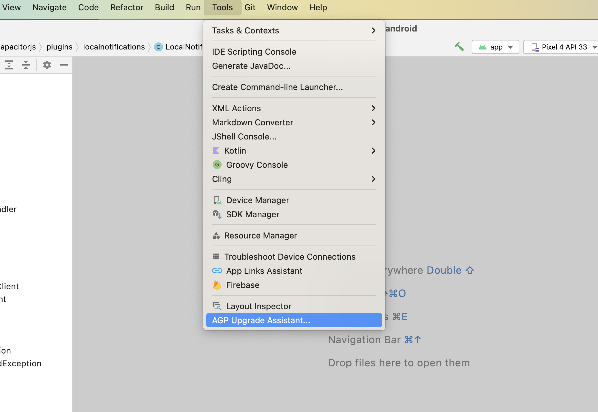

# Updating from Capacitor 8 to Capacitor 9

In this guide, you'll find steps to update your project to the current Capacitor 9 version as well as a list of breaking changes for our official plugins.

:::note
This guide covers app-level changes. If you maintain a Capacitor plugin, see [Updating plugins to 9.0](/main/updating/plugins/9-0.md) instead.
:::

## Cordova support is now optional

Capacitor's Cordova compatibility layer is now only included in your app when your project actually has a Cordova plugin installed. Previously, the native Cordova runtime (the `capacitor-cordova-android` Gradle module and plugins module on Android, and the `CapacitorCordova` CocoaPods pod / SPM product on iOS) was always bundled into every app, whether or not it used any Cordova plugins.

Running `npx cap sync` (or `update`) now detects whether any installed plugin is a Cordova plugin and only wires in the Cordova runtime when one is found. If your project has no Cordova plugins, you'll notice:

- On Android, the generated `settings.gradle` and app `build.gradle` no longer include the `capacitor-cordova-android` / `capacitor-cordova-android-plugins` modules.
- On iOS, `CapacitorCordova` is no longer added to your `Podfile` or `Package.swift`.

There is currently no configuration option to force-include the Cordova runtime when no Cordova plugin is present. If your app's native code (or a plugin you maintain) directly references symbols from Capacitor's Cordova compatibility layer — for example `com.getcapacitor.cordova.CordovaPlugin` on Android, or anything from the `CapacitorCordova` pod/product on iOS — without having an actual Cordova plugin installed, those references will fail to resolve after upgrading. Add a Cordova plugin dependency (even a trivial one) if you need the layer present, or remove the direct reference.

## Breaking changes in @capacitor/cli

`cap run`'s separate live-reload flags (`--live-reload`/`-l`, `--host`, `--port`, `--https`) have been merged into a single `--url` flag. Instead of:

```sh
npx cap run android -l --host 192.168.1.181 --port 5173
```

pass the full URL your dev server printed (Vite, webpack, etc.) directly:

```sh
npx cap run android --url http://192.168.1.181:5173
```

## NodeJS 24+

Capacitor 9 requires NodeJS 24 or greater. (Latest LTS version is recommended.) Node 24 also comes with npm 11 by default, as opposed to npm 10 with Node 22.

## Using the CLI to Migrate

Capacitor 9 hasn't reached general availability yet, so install the `next` version of the Capacitor CLI to your project (once 9.0.0 is generally available, use `@latest` instead):

```sh
npm i -D @capacitor/cli@next
```

Once installed, simply run the following to have the CLI handle the migration for you.

```sh
npx cap migrate
```

If any of the steps for the migration are not able to be completed, additional information will be made available in the output in the terminal. The steps for doing the migration manually are listed out below.

## Breaking changes in @capacitor/android

`androidx.core:core` 1.19.0 folds `core-ktx` into itself, and AGP 9 bundles the Kotlin Gradle Plugin natively while Gradle 9 fully removes `jcenter()`. These rarely affect an app directly, unless you (or an old/community plugin) still pin an old `core-ktx` version, apply Kotlin standalone, or reference `jcenter()` — see [Migrate core-ktx to core](#migrate-core-ktx-to-core) and [Update Kotlin and remove jcenter()](#update-kotlin-and-remove-jcenter) below.

Capacitor 9 also removes the Java APIs that were deprecated in previous major versions, most of them used by plugin authors — see [Breaking changes in code](/main/updating/plugins/9-0.md#android). If your app has custom native code, check that list too.

## Breaking changes in @capacitor/ios

Capacitor 9 boots iOS apps from a SwiftUI `App` struct instead of a UIKit `AppDelegate`. Your app project gains `App.swift` and `CapacitorView.swift`, the `AppDelegate` is demoted to a `@UIApplicationDelegateAdaptor`, and `SceneDelegate.swift` and `Main.storyboard` are deleted. Every app needs this change, including apps already on 8.5 — see [Adopt the SwiftUI entry point](#adopt-the-swiftui-entry-point) below.

If you're updating from Capacitor 8.4 or earlier, read [Updating to 8.5](/main/updating/8-5.md) as well. It covers the iOS UIScene lifecycle that the SwiftUI entry point builds on, and its audit section lists the custom native code patterns that both changes affect.

Capacitor 9 also removes the Swift and Objective-C APIs that were deprecated in previous major versions, most of them used by plugin authors — see [Breaking changes in code](/main/updating/plugins/9-0.md#ios). If your app has custom native code (for example `CAPBridge.handleOpenUrl` in your AppDelegate), check that list too.

## iOS

The following guide describes how to upgrade your Capacitor 8 iOS project to Capacitor 9.

### Upgrade Xcode

Capacitor 9 requires Xcode 27 or newer.

### Raise iOS Deployment Target

Capacitor 9 requires iOS 16.0 or greater.

Do the following for your Xcode project: select the **Project** within the project editor and open the **Build Settings** tab. Under the **Deployment** section, change **iOS Deployment Target** to **iOS 16.0**. Repeat the same steps for any app **Targets**.

Then, if the project is using CocoaPods, open `ios/App/Podfile` and update the iOS version to 16.0:

```ruby
platform :ios, '16.0'
```

### Adopt the SwiftUI entry point

`@main` moves out of `AppDelegate.swift` into a new `App.swift`, SwiftUI declares the app's scene, and `CAPBridgeViewController` is hosted inside that scene through a `UIViewControllerRepresentable`. The UIKit entry point it replaces — `SceneDelegate.swift`, `Main.storyboard`, and the `UIWindow` the AppDelegate owned — is removed.

:::warning
Swift 6 (bundled with Xcode 27) rejects the deprecated `@UIApplicationMain` attribute, but don't replace it with `@main`. In Capacitor 9 `@main` belongs on the `App` struct in `App.swift`. Delete the attribute from `AppDelegate` instead — an app that declares two entry points doesn't compile.
:::

These are the files that change:

- `App.swift` — new. An `@main` struct conforming to `App`. It adopts the `AppDelegate` through `@UIApplicationDelegateAdaptor` and declares a `WindowGroup` scene containing `CapacitorView()`.
- `CapacitorView.swift` — new. A `UIViewControllerRepresentable` that makes `CAPBridgeViewController` available to SwiftUI.
- `AppDelegate.swift` — demoted. It conforms to `NSObject` instead of `UIResponder` and keeps only `application(_:didFinishLaunchingWithOptions:)`. The `@main` attribute, the `window` property, `application(_:configurationForConnecting:options:)`, `application(_:open:options:)`, and `application(_:continue:restorationHandler:)` all go.
- `Info.plist` — `UIApplicationSceneManifest` is reduced to `UIApplicationSupportsMultipleScenes`, because SwiftUI declares the scene itself. `UIMainStoryboardFile` is removed.
- `SceneDelegate.swift` and `Base.lproj/Main.storyboard` — deleted. `LaunchScreen.storyboard` stays; iOS still requires a launch storyboard.

`App.swift` and `CapacitorView.swift` are the same file in the SPM and CocoaPods templates. The only difference between the two is the import block of `AppDelegate.swift`, noted in the steps below.

### What the CLI migrates automatically

For a project that still matches the Capacitor template shape, `npx cap migrate` applies the whole change: it writes `App.swift` and `CapacitorView.swift`, registers both with the Xcode App target, rewrites `AppDelegate.swift`, updates `Info.plist`, and deletes `SceneDelegate.swift` and `Main.storyboard`. Each step is idempotent, so a run that stops part-way is finished by running `npx cap migrate` again.

The migrator skips the automated rewrite and prints the manual steps instead when your `AppDelegate.swift`:

- has no `AppDelegate` class;
- manages its own `UIWindow`, which the SwiftUI `App` struct now owns;
- has a custom `application(_:open:options:)` or `application(_:continue:restorationHandler:)` body, which scenes no longer call.

Three partial outcomes are worth watching for in the terminal output:

- An `AppDelegate.swift` that carries code of your own is converted in place rather than replaced with the Capacitor 9 template. Check what it still holds against step 3 below.
- A `SceneDelegate.swift` that carries code of your own is kept, and the app no longer uses it. Move its window setup into `App.swift` and its URL and activity handling into the SwiftUI scene body, then follow step 5 to delete it.
- A `UIApplicationSceneManifest` that names a scene delegate class other than `SceneDelegate` is left untouched. Follow step 4 once that delegate is ported into the SwiftUI scene body.

### Migrate the entry point by hand

Follow these steps when `npx cap migrate` skips the rewrite, or when you'd rather apply the change yourself. The starting point is a Capacitor 8.5 project; if you're on 8.4 or earlier, [adopt the UIScene lifecycle](/main/updating/8-5.md) first.

#### 1. Add App.swift

Create `App/App/App.swift`. This is the app's new entry point:

```swift
import SwiftUI
import Capacitor

@main
struct CapacitorApp: App {
    @UIApplicationDelegateAdaptor(AppDelegate.self) var appDelegate

    var body: some Scene {
        WindowGroup {
            CapacitorView()
                .ignoresSafeArea()
                .onOpenURL { url in
                    SceneDelegateProxy.shared.handle(openURL: url)
                }
                .onContinueUserActivity(NSUserActivityTypeBrowsingWeb) { activity in
                    SceneDelegateProxy.shared.handle(userActivity: activity)
                }
        }
    }
}
```

`@UIApplicationDelegateAdaptor` keeps your `AppDelegate` alive for the app-level callbacks that survive the scene lifecycle, such as push notification registration. `.ignoresSafeArea()` hands the full window to the WebView, which manages its own insets.

#### 2. Add CapacitorView.swift

Create `App/App/CapacitorView.swift`. It wraps the bridge view controller so SwiftUI can host it:

```swift
import SwiftUI
import Capacitor

public struct CapacitorView: UIViewControllerRepresentable {
    public func makeUIViewController(context: Context) -> CAPBridgeViewController {
        CAPBridgeViewController()
    }

    public func updateUIViewController(_ vc: CAPBridgeViewController, context: Context) {}
}
```

If your app uses a `CAPBridgeViewController` subclass, return it from `makeUIViewController(context:)` instead.

#### 3. Slim down AppDelegate.swift

`App.swift` now owns the entry point, the window, and the scene, so most of the AppDelegate goes:

```diff
 import UIKit
-import Capacitor

-@main
-class AppDelegate: UIResponder, UIApplicationDelegate {
-
-    var window: UIWindow?
+class AppDelegate: NSObject, UIApplicationDelegate {

     func application(_ application: UIApplication, didFinishLaunchingWithOptions launchOptions: [UIApplication.LaunchOptionsKey: Any]?) -> Bool {
         return true
     }
-
-    func application(_ application: UIApplication,
-                     configurationForConnecting connectingSceneSession: UISceneSession,
-                     options: UIScene.ConnectionOptions) -> UISceneConfiguration {
-        let config = UISceneConfiguration(name: "Default Configuration",
-                                          sessionRole: connectingSceneSession.role)
-        config.delegateClass = SceneDelegate.self
-        return config
-    }
 }
```

The Capacitor 9 CocoaPods template also lists `import Foundation` above `import UIKit`. It's redundant — UIKit re-exports Foundation — so a CocoaPods project takes the same diff as an SPM one.

If your AppDelegate still declares `application(_:open:options:)` or `application(_:continue:restorationHandler:)`, remove them too. Scenes stopped calling those methods when you adopted the UIScene lifecycle in 8.5, and the SwiftUI scene body now routes both — see [Route URL schemes and universal links](#route-url-schemes-and-universal-links).

The empty `applicationWillResignActive`, `applicationDidEnterBackground`, `applicationWillEnterForeground`, `applicationDidBecomeActive`, and `applicationWillTerminate` stubs that older templates shipped aren't called under the scene lifecycle either. The Capacitor 9 template drops them. If you added code to any of them, move it before you delete the method.

#### 4. Update Info.plist

SwiftUI declares the scene, so the manifest no longer names a configuration or a delegate class. Reduce it to a single key, and remove `UIMainStoryboardFile` if your project still sets it:

```diff
 <key>UIApplicationSceneManifest</key>
 <dict>
     <key>UIApplicationSupportsMultipleScenes</key>
     <false/>
-    <key>UISceneConfigurations</key>
-    <dict>
-        <key>UIWindowSceneSessionRoleApplication</key>
-        <array>
-            <dict>
-                <key>UISceneConfigurationName</key>
-                <string>Default Configuration</string>
-                <key>UISceneDelegateClassName</key>
-                <string>$(PRODUCT_MODULE_NAME).SceneDelegate</string>
-                <key>UISceneStoryboardFile</key>
-                <string>Main</string>
-            </dict>
-        </array>
-    </dict>
 </dict>
 <key>UILaunchStoryboardName</key>
 <string>LaunchScreen</string>
```

Leave `UILaunchStoryboardName` alone. `LaunchScreen.storyboard` is still required.

#### 5. Delete SceneDelegate.swift and Main.storyboard

`App.swift` replaces both. Delete `App/App/SceneDelegate.swift` and `App/App/Base.lproj/Main.storyboard`, and remove their references from the App target. Deleting the files through Xcode removes the references for you; if you edit `project.pbxproj` by hand, each file needs its `PBXFileReference`, `PBXBuildFile`, group entry, and build-phase entry removed.

Move anything your `SceneDelegate` did beyond creating the window into `App.swift` first.

#### 6. Register the new files and sync

Add `App.swift` and `CapacitorView.swift` to the App target. Xcode does this when you add the files through the IDE. By hand, each file needs a `PBXFileReference`, a `PBXBuildFile`, an entry in the `App` group, and an entry in the target's Sources build phase.

Then run `npx cap sync ios`.

### Route URL schemes and universal links

Custom URL schemes and universal links reach the app through the SwiftUI scene body. `.onOpenURL` forwards to `SceneDelegateProxy.shared.handle(openURL:)` and `.onContinueUserActivity(NSUserActivityTypeBrowsingWeb)` forwards to `SceneDelegateProxy.shared.handle(userActivity:)`, which post the same notifications the AppDelegate and scene delegate paths posted before. Plugins that listen for `.capacitorOpenURL` or `.capacitorOpenUniversalLink` keep working, and `App.getLaunchUrl()` keeps returning the launch URL.

App-specific routing of your own goes in the same place. Code that used to live in `AppDelegate.application(_:open:options:)`, or in `SceneDelegate.scene(_:openURLContexts:)`, belongs in the `.onOpenURL` closure, alongside the forwarding call:

```swift
.onOpenURL { url in
    MyRouter.handle(url)
    SceneDelegateProxy.shared.handle(openURL: url)
}
```

### Audit your custom native code

Most apps need nothing beyond the steps above. Check your own native code and any custom plugins for these patterns, which `npx cap migrate` also reports when it finds them:

- A `UIWindow` created or configured outside `App.swift`. The SwiftUI `App` struct owns the window now. Root view controller customization belongs in `CapacitorView`, and window-level customization in the scene body.
- Custom `application(_:open:options:)` or `application(_:continue:restorationHandler:)` bodies. Move them into the SwiftUI scene body as shown above.
- `UIApplication.shared.applicationState`. Read the window scene's `activationState` instead.
- `tmpWindow` or `TmpViewController`. Both were removed in Capacitor 8.5. Use the bridge's `viewController` as the presentation anchor.

The [audit section of the 8.5 guide](/main/updating/8-5.md#audit-your-custom-code-and-plugins) covers the UIScene side of these in more detail.

### Verify the iOS migration

After migrating, confirm on a device or simulator:

- The project builds on Xcode 27 with no duplicate entry point error.
- The app launches and renders your web app.
- Backgrounding and foregrounding the app fires the JavaScript `pause` and `resume` events.
- A custom URL scheme open reaches the app both cold (app killed, then link tapped) and warm (app running). Check both the `appUrlOpen` listener and `App.getLaunchUrl()`.
- Universal links route into the app, if your app uses them.

:::note
CocoaPods Trunk is expected to become read-only on December 2, 2026. If you haven't already, consider [migrating your app to SPM](/main/ios/spm.md#using-spm-in-an-existing-capacitor-project), which is the default for new Capacitor projects.
:::

## Android

The following guide describes how to upgrade your Capacitor 8 Android project to Capacitor 9.

### Upgrade Android Studio

Capacitor 9 requires Android Studio 2026.1.1 or newer.

Once it's updated, Android Studio can assist with some of the updates related to gradle. To start, run `Tools -> AGP Upgrade Assistant` and choose `9.2.1` as the version to update on dropdown. Then click `Run selected steps`.



### Clean up gradle.properties

AGP 9 changed the defaults of several `gradle.properties` flags, and the AGP Upgrade Assistant writes them back explicitly so your build keeps the AGP 8 behavior. A Capacitor app needs none of them: most are deprecated and will be removed in AGP 10, and a couple actively break a Capacitor 9 build (`android.builtInKotlin=false` turns off the Kotlin support that AGP 9 now bundles, and `android.sdk.defaultTargetSdkToCompileSdkIfUnset=false` stops AGP from inferring `targetSdkVersion`). Remove them:

```diff
# gradle.properties

- android.defaults.buildfeatures.resvalues=true
- android.sdk.defaultTargetSdkToCompileSdkIfUnset=false
- android.enableAppCompileTimeRClass=false
- android.usesSdkInManifest.disallowed=false
- android.uniquePackageNames=false
- android.dependency.useConstraints=true
- android.r8.strictFullModeForKeepRules=false
- android.r8.optimizedResourceShrinking=false
- android.builtInKotlin=false
- android.newDsl=false
```

### Update Android Project Variables

In your `variables.gradle` file, update your values to the following new minimums

```groovy
minSdkVersion = 26
compileSdkVersion = 37
targetSdkVersion = 37
androidxActivityVersion = '1.13.0'
androidxAppCompatVersion = '1.7.1'
androidxCoordinatorLayoutVersion = '1.3.0'
androidxCoreVersion = '1.19.0'
androidxFragmentVersion = '1.8.9'
coreSplashScreenVersion = '1.2.0'
androidxWebkitVersion = '1.16.0'
junitVersion = '4.13.2'
androidxJunitVersion = '1.3.0'
androidxEspressoCoreVersion = '3.7.0'
cordovaAndroidVersion = '15.0.0'
```

### Remove targetSdkVersion from your app's build.gradle

AGP 9 infers `targetSdkVersion` from `compileSdkVersion` when it isn't set explicitly, therefore you can remove it:

```diff
defaultConfig {
    applicationId "com.getcapacitor.app"
    minSdkVersion rootProject.ext.minSdkVersion
-   targetSdkVersion rootProject.ext.targetSdkVersion
    versionCode 1
    versionName "1.0"
}
```

### Rename the default ProGuard file

AGP 9 removed `proguard-android.txt`. In your `app/build.gradle`, replace it with `proguard-android-optimize.txt`, which also enables ProGuard optimizations:

```diff
buildTypes {
    release {
        minifyEnabled false
-       proguardFiles getDefaultProguardFile('proguard-android.txt'), 'proguard-rules.pro'
+       proguardFiles getDefaultProguardFile('proguard-android-optimize.txt'), 'proguard-rules.pro'
    }
}
```

### Declare dependency versions in your app's build.gradle

Your `app/build.gradle` references version variables that are declared in the root project's `variables.gradle`, and relies on Gradle walking up the project hierarchy to resolve them. That implicit lookup is deprecated in Gradle 9.6 and becomes an error in Gradle 10, so declare them explicitly at the top of the file:

```diff
apply plugin: 'com.android.application'

+ def androidxAppCompatVersion = rootProject.ext.androidxAppCompatVersion
+ def androidxCoordinatorLayoutVersion = rootProject.ext.androidxCoordinatorLayoutVersion
+ def coreSplashScreenVersion = rootProject.ext.coreSplashScreenVersion
+ def junitVersion = rootProject.ext.junitVersion
+ def androidxJunitVersion = rootProject.ext.androidxJunitVersion
+ def androidxEspressoCoreVersion = rootProject.ext.androidxEspressoCoreVersion

android {
```

Those are the variables the Capacitor template declares. If your app references any other variable from `variables.gradle`, for example a dependency version used by a local plugin, declare it here too.

### Migrate core-ktx to core

`androidx.core:core` 1.19.0 merges every extension function previously shipped in `core-ktx` into `core` itself, turning `core-ktx` into an empty compatibility artifact. If your app (or an old/community plugin it depends on) still explicitly depends on `core-ktx` with a version older than `1.19.0`, you may hit a duplicate class error at build time; remove it, or depend on `core` instead:

```diff
dependencies {
-   implementation "androidx.core:core-ktx:1.17.0"
+   implementation "androidx.core:core:1.19.0"
}
```

### Update Kotlin and remove jcenter()

AGP 9 bundles the Kotlin Gradle Plugin natively (Kotlin `2.2.10`) instead of requiring it to be applied as a separate plugin. If your `build.gradle` still applies `kotlin-android` directly or declares a standalone `kotlin-stdlib`/`kotlin-gradle-plugin` dependency, remove them — keeping them alongside AGP 9's built-in Kotlin causes a duplicate-plugin build failure:

```diff
buildscript {
    dependencies {
        classpath 'com.android.tools.build:gradle:9.2.1'
-       classpath "org.jetbrains.kotlin:kotlin-gradle-plugin:2.2.20"
    }
}
-apply plugin: 'kotlin-android'

dependencies {
-   implementation "org.jetbrains.kotlin:kotlin-stdlib:2.2.20"
}
```

Gradle 9 also fully removes the `jcenter()` repository helper (redirected to Maven Central since 2024). Any `build.gradle` that still calls it fails at Gradle configuration time:

```diff
repositories {
    google()
-   jcenter()
+   mavenCentral()
}
```

### Update google services plugin

```diff
# build.gradle

    dependencies {
        classpath 'com.android.tools.build:gradle:9.2.1'
-       classpath 'com.google.gms:google-services:4.4.4'
+       classpath 'com.google.gms:google-services:4.5.0'

```

### Update gradle plugin to 9.2.1

```diff
# build.gradle

    dependencies {
-       classpath 'com.android.tools.build:gradle:8.13.0'
+       classpath 'com.android.tools.build:gradle:9.2.1'

```

### Update gradle wrapper to 9.5.1

```diff
# gradle-wrapper.properties

distributionBase=GRADLE_USER_HOME
distributionPath=wrapper/dists
- distributionUrl=https\://services.gradle.org/distributions/gradle-8.14.3-all.zip
+ distributionUrl=https\://services.gradle.org/distributions/gradle-9.5.1-all.zip
zipStoreBase=GRADLE_USER_HOME
zipStorePath=wrapper/dists
```

## Plugins

Plugins have been updated to version 9.0.0, make sure to update them to use latest version.

The following plugin functionality has been modified or removed. Update your code accordingly.

### Action Sheet

- `androidxMaterialVersion` variable has been updated to `1.14.0`.

### Barcode Scanner

- `kotlinxCoroutinesVersion` variable has been updated to `1.11.0`.

### Browser

- `androidxBrowserVersion` variable has been updated to `1.10.0`.

### Camera

- `androidxExifInterfaceVersion` variable has been updated to `1.4.2`.
- `androidxMaterialVersion` variable has been updated to `1.14.0`.

### Geolocation

- `playServicesLocationVersion` variable has been updated to `21.4.0`.
- `kotlinxCoroutinesVersion` variable has been updated to `1.11.0`.

### Google Maps

- `kotlinxCoroutinesVersion` variable has been updated to `1.11.0`.
- `googleMapsPlayServicesVersion` variable has been updated to `20.0.0`.
- `googleMapsUtilsVersion` variable has been updated to `5.0.0`.
- `googleMapsKtxVersion` and `googleMapsUtilsKtxVersion` variables have been updated to `6.0.1`.

### InAppBrowser

- `androidxBrowserVersion` variable has been updated to `1.10.0`.

### Push Notifications

The deprecated `alert` presentation option is no longer supported on iOS. Use `banner` and/or `list` instead.

### Splash Screen

The default value of `launchFadeOutDuration` on Android has changed from `200` to `0`, since the previous default could block UI changes made immediately after `SplashScreen.hide()`. If your app relies on the previous 200ms fade-out animation, set `launchFadeOutDuration: 200` explicitly in your Capacitor config.
